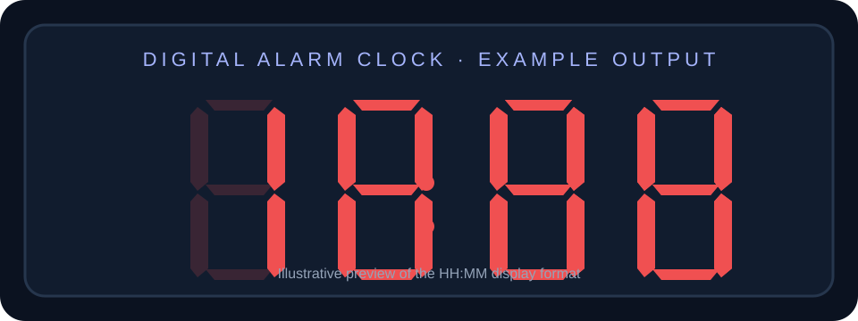
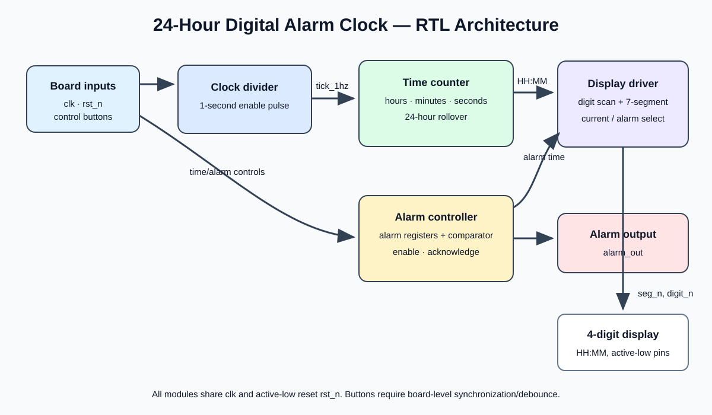

# 24-Hour Digital Alarm Clock (Verilog RTL)

A modular Verilog HDL implementation of a 24-hour digital clock with an adjustable alarm and a multiplexed four-digit seven-segment display. The clock keeps hours, minutes, and seconds; the display shows hours and minutes (`HH:MM`). The alarm compares the current hour and minute with the saved alarm time and asserts `alarm_out` when they match.



## RTL block diagram



The block diagram describes the logical RTL. It is not a board-specific wiring schematic: FPGA package pins, display polarity, and any transistor drivers depend on the target board.

## Features

- 24-hour timekeeping with hour, minute, and second counters
- Adjustable current time and alarm time, with wraparound at 23 hours and 59 minutes
- Alarm enable and acknowledge controls
- Four-digit multiplexed `HH:MM` display, with a switch to show the alarm setting
- Parameterized input clock and display scan rate
- Separate RTL modules and a simulation testbench

## Repository contents

| File | Purpose |
| --- | --- |
| `digital_alarm_clock.v` | Top-level module and module wiring |
| `clock_divider.v` | Generates a one-clock-wide one-second enable pulse |
| `time_counter.v` | Hour, minute, and second counters |
| `alarm_controller.v` | Alarm-time registers, comparison, and acknowledge behavior |
| `seven_seg_driver.v` | Multiplexed active-low four-digit display driver |
| `tb_digital_alarm_clock.v` | Testbench for reset, minute wrap, alarm, and display signals |
| `images/rtl-block-diagram.svg` | Logical RTL diagram |
| `images/display-preview.svg` | Illustrative example of the display output |

## Top-level interface

All control inputs are active-high. `rst_n` is an asynchronous active-low reset. `seg_n`, `digit_n`, and `dp_n` are active-low outputs; the segment bit order is `abcdefg`.

| Signal | Direction | Description |
| --- | --- | --- |
| `clk` | Input | Board clock; default design parameter assumes 50 MHz |
| `rst_n` | Input | Active-low reset; resets clock and alarm time to 00:00:00 / 00:00 |
| `set_time` | Input | Enables current-time adjustment |
| `inc_hour`, `inc_min` | Input | Increment the selected current-time field while `set_time` is high |
| `set_alarm` | Input | Enables alarm-time adjustment |
| `inc_alarm_hour`, `inc_alarm_min` | Input | Increment the selected alarm field while `set_alarm` is high |
| `alarm_enable` | Input | Enables alarm triggering |
| `alarm_ack` | Input | Silences a currently active alarm |
| `show_alarm` | Input | Selects alarm time rather than current time for the display |
| `alarm_out` | Output | Active-high alarm signal; connect to a buzzer driver or LED as appropriate |
| `seg_n[6:0]` | Output | Active-low segments in `abcdefg` order |
| `digit_n[3:0]` | Output | Active-low digit selects |
| `dp_n` | Output | Active-low decimal-point output; held inactive in this design |

Adjustment buttons increment on each active clock edge while held. Add one-pulse/debounce logic if you want a physical press to count exactly once.

## Simulate on Linux

Install Icarus Verilog. On Ubuntu or Debian:

```bash
sudo apt update
sudo apt install iverilog
```

From this directory, compile and run the testbench:

```bash
iverilog -g2012 -s tb_digital_alarm_clock -o simv \
  clock_divider.v time_counter.v alarm_controller.v \
  seven_seg_driver.v digital_alarm_clock.v tb_digital_alarm_clock.v
vvp simv
```

The testbench is expected to print a `PASS` line and finish. To create a waveform, add `$dumpfile("alarm_clock.vcd"); $dumpvars(0, tb_digital_alarm_clock);` near the start of the testbench's `initial` block, then run `gtkwave alarm_clock.vcd` after simulation.

## FPGA implementation

1. Create a project in the vendor tool for your board (for example, Vivado for AMD/Xilinx or Quartus for Intel/Altera).
2. Add the five design source files listed above. Set `digital_alarm_clock` as the top module. Add the testbench as a simulation source, not a synthesis source.
3. Set `CLK_HZ` in the top-level instance to the board's actual clock frequency. The default is 50,000,000 Hz. `SCAN_DIV` controls the scan interval per digit; the default is 50,000 input-clock cycles.
4. Add a clock constraint and board-specific pin assignments for the clock, controls, segments, digit selects, and alarm output.
5. Confirm your display's segment order and electrical polarity. The RTL outputs are active-low; a board with different polarity may need inversion.
6. Synchronize and debounce asynchronous mechanical buttons. Consider adding a one-shot pulse generator so holding a button does not cause rapid repeated increments.
7. Synthesize, implement, program the FPGA, and connect `alarm_out` to a suitable buzzer driver or indicator. Do not drive a high-current buzzer directly from an FPGA pin.

No board constraints are included because the correct pins and electrical interface depend on the FPGA board and display module.

## Output Waveform


## Design notes

- The divider creates a clock-enable pulse; the design does not use a divided signal as a separate clock.
- Alarm time is checked at the current minute. A match activates `alarm_out` once while the clock remains in that minute. `alarm_ack` clears the active alarm; it will not retrigger until the time leaves and later re-enters the matching minute. Disabling `alarm_enable` also clears the active output.
- This is a learning/demo RTL design. It does not include battery backup, a real-time clock, time-of-day persistence, button conditioning, or board pin constraints.

## License

Provided for educational use. Add a repository license file if you want to specify reuse terms.
